# October 6: Initial Brainstorming + Research and Final Plan

**(For context, this project was originally meant to be a submission for the Half-Lie YSWS, where I needed to create a PCB in under a week and had a budget of $65 for the keyboard PCB. The first few journals are written with my thinking I am making this keyboard for Half-Life.)**

From the start of Week 1, I knew that I wanted to design and build a custom mechanical keyboard. Creating a keyboard was already something I had been interested in (due to the KEEB YSWS), and Half Life gave me the motivation to finally begin the project.

Since Monday, I have spent approximately 2.4 hours of pure brainstorming and researching keyboard design. This consisted of two dedicated 2 hour research/discovery sessions, along with additional idea development throughout during small spare moments in my day, such as lunch breaks and my train rides to and from school. Based on my browser history, Google Docs revision history, and the time spent sketching concepts, I feel that 2.6 hours is a fair estimate of my work so far.

During this research process, I learned about and decided on different keyboard layouts and form factors, mechanical switch types (linear, tactile, and clicky), keycap profile options, adding custom macro functionality, and general keyboard construction methods! I am now super ready to begin making my schematic! The Hack Club KEEB YSWS guide was especially helpful in helping me get my foot in the door with regards to understanding the overall design process and the components required for a custom keyboard. I put my notes and brainstorming ideas on a google doc and then polished it up with my final design idea:

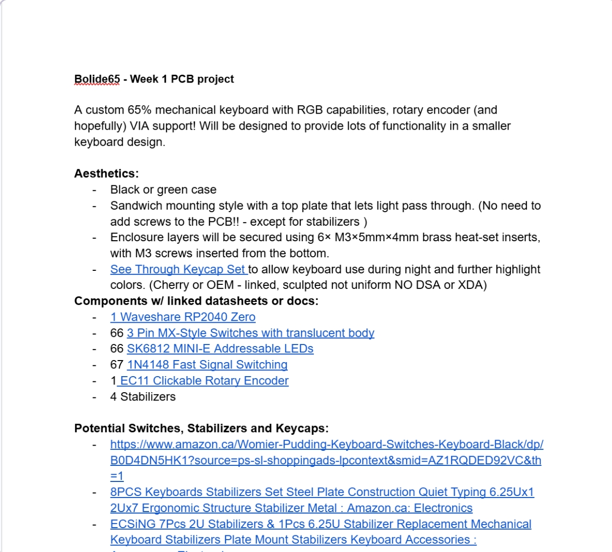

**Project Inspiration**
This project will kill two birds with one stone: help develop my hardware skills and also help my younger sister. As I explained in my idea reel, I am designing this keyboard for my sister because a few of her keys on her laptop keyboard have stopped functioning properly. She has continuously expressed annoyance at how this makes completing school assignments much more frustrating. Since she will likely need to wait a whole year before replacing her laptop, I wanted to create an external keyboard that she can use in the meantime.

**Design Explanation**
I named the project “Bolide” because I want its LEDs to be a major part of its visual identity. The keyboard will feature LED backlighting and keycaps that allow the LEDs to shine through. I also plan to use a sandwich mounting design with a translucent top plate, allowing light to pass throughout the keyboard and emphasize its aestheticss

After researching different layouts and components, I settled on a 65% keyboard layout (I was debating on 75% and TKL, but was worried it would be too expensive to make - I think the 65% will allow me to stay under tier 2 budget). To restore lost functionality, I will add a fn key that will allow my sister to still access a hidden function key layer on the number pad.

Some other notable choices is that I chose linear switches (as my sister did not express a strong preference for a specific kind, so I chose the simpler option), a rotary encoder that will likely be volume control and custom macro keys replacing the Delete, Page Up, and Page Down keys.

Before finalizing the design, I tried sketching out layouts based on a few 65% layouts I liked… but inevitably failed (none of them looked nice or helpful). So I just recorded my decisions and then tried to draw the general shape of the keyboard. Once I was satisfied with the concept, I finalized the layout using [Keyboard Layout Editor NG](https://editor.keyboard-tools.xyz/). I will use this layout for making the top plate when doing CAD. (I’m NOT using it to generate traces for my PCB!!)

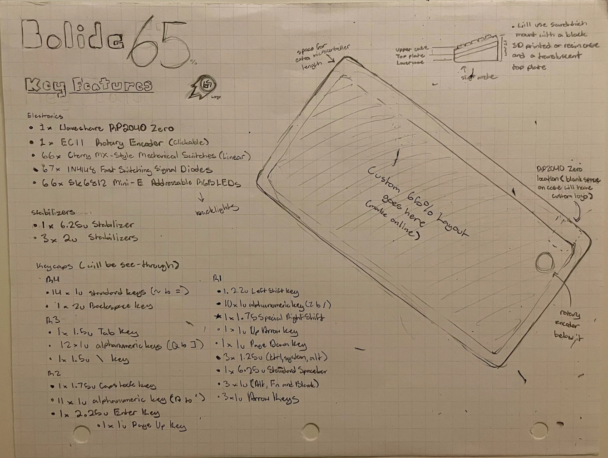
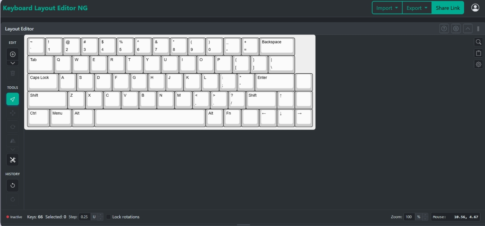

At this stage, I have completed the initial planning and research phase. My next steps will be beginning the PCB design process!! See ya tomorrow

**Total time spent: 2.6 hours**

# October 7: Started Schematic

Did a work session this evening where I focused on starting the PCB schematic for my keyboard! 

I spent the first few minutes of my session ensuring I have sucessfully imported right symbols and footprints I will need for my schematic. I specifcally had to upload the schematic for the RP2040 Zero (the microcontroller I chose to use for this project) and download the marblastlib library from the ebastler KiCAD Repository (has all the keyboard specific symbols and footprints I will need). I had to keep pausing the timelaspe so I could do some extra reading regarding the components I was using and the way I was setting up my schematic to ensure I was not messing up anywhere.

Afterwards, I got to start on the keyboard matrix as I figured it would take most of my time. For my keyboard matrix, I am using 9 columns and 8 rows to connect all 66 keys and the clicker function of my rotary enocder to the RP2040. With this configuration, the RP2040 Zero has just enough GPIO pins left over for all the components I want to include in this keyboard. I was planning to work for two hours, but cut the session short as some delays made me work a bit later than I wanted and I realized I may have incorrectly planned for how many keys would be in the last row of my matrix. I'll double check my work and hopefully finish the schematic tommorow.

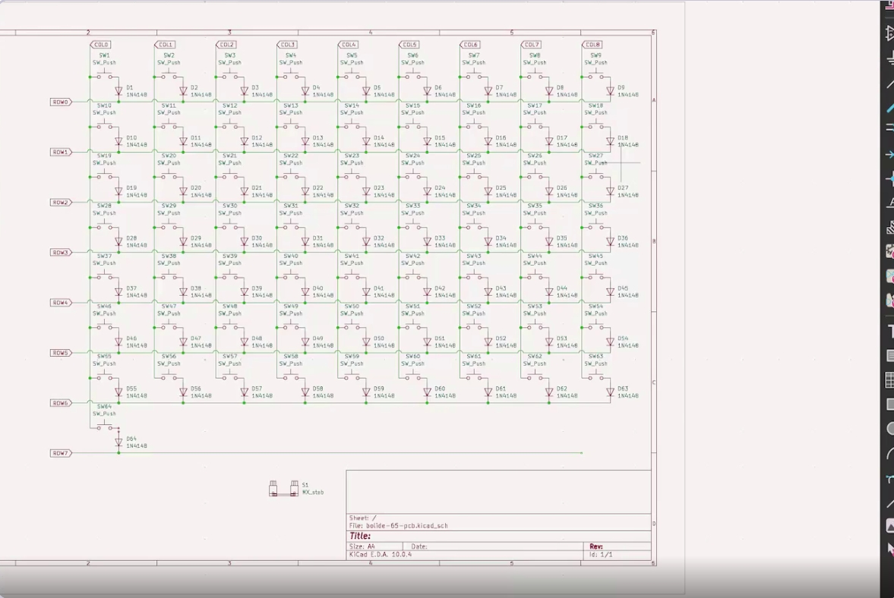

[**Laspe Recording**](https://lapse.hackclub.com/timelapse/WhSj9wUxpo-r)

**Total time spent: 1.48 hours**

# October 8: The Schematic is Almost Done!

After yesterday's session, I figured out how to properly add my rotary encoder to the keyboard matrix and also determined my original matrix plan was missing two keys on the last row. So today I fixed those two things and double checked all my connections.

I thing I want to work on during this project is producing clean schematics and routing. I think I am making some progress on that goal as today, I learned how to create sub-sheets in KiCad to isolate certain parts of the schematic. Additionally, as a double check to ensure I had all the keys I needed in my schematic, and to increase the clarity of my PCB, I labelled each switch with its corresponding keycap label (based on my keymap design).

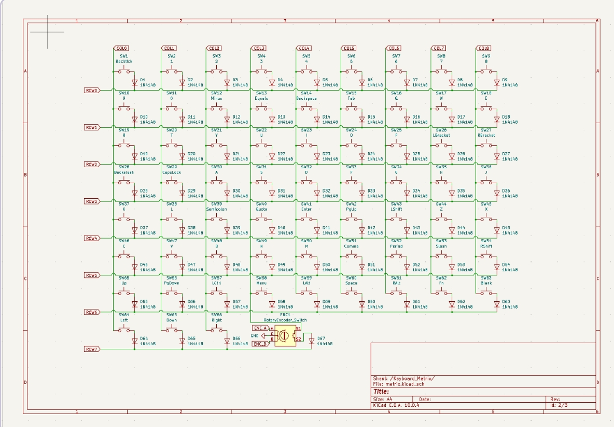

After finishing my keyboard matrix, I linked up my rows and columns to my main microcontroller, the RP2040 Zero. While I was at it, I also added the necessary power symbols and other connections to board schematic. The main reason I chose it is because it has a small size that still supports just enough GPIO pins for me to fit all the features I want!

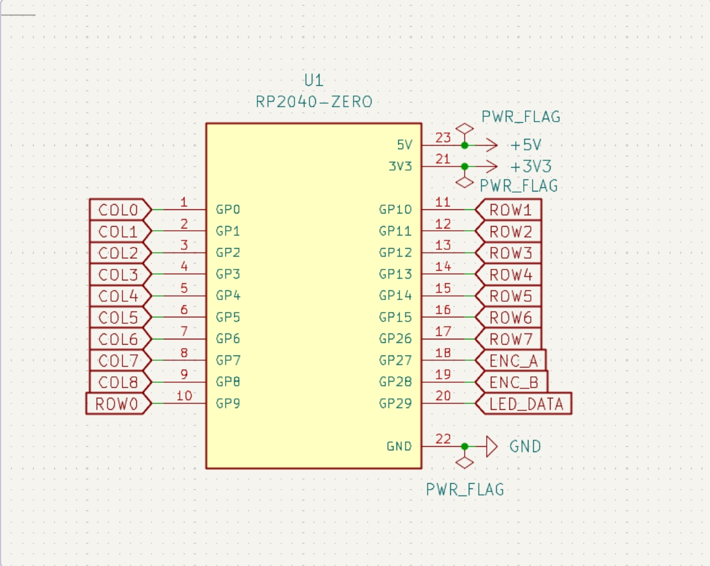

I then began making my LED daisy chain. I went into it thinking I could create a larger version of the daisy chain I made for my macropad, but after I finished creating the main chain and was comparing it with my own past design (for my macropad) and other online schematics, I noticed many designs from other people had capacitors in them. I'm going to have to do a bit more research before I finalize the data chain for my SK6812 MINI-E LEDs. Once that is done, I can move on to the actual PCB design!

[**Laspe Recording:** Finishing Keyboard Matrix](https://lapse.hackclub.com/timelapse/16NFAEM3M887)

[**Laspe Recordng:** Working on LED Data Chain](https://lapse.hackclub.com/timelapse/T1WGkkZpFPrV)

(I added a bit more extra time from my timelapse to account for one moment I forgot to unpause my recording when adjusting the LED symbol names as well as the preliminary time I spent confirming my schematic plan with datasheets)

**Total time spent: 2.02 hours**

# October 9: Working on Data Chain

Today, I figured out what else my LED daisy chain needs! I learned that due to keyboards being significantly larger than macropads, they are more likey to experience electrical noise and voltage fluctuations that could cause my LEDs to glitch or become damaged. As a result, I decided I will be adding a level shifter (increases the 3V3 output of the RP2040 Zero to the 5V the LEDs need), a resistor at the start of the chain (to prevent the LEDs from drawing too much current and dampen high frequency signal reflections) and ceramic capacitors near each LED (to smooth out voltage fluctuations when a bunch of LEDs change color at once, preventing flickering or wrong color changes). I also considered adding a bulk capacitor to further help with brightness issues, but I found I can just limit the brightness of the LEDs in the firmware to achieve the same protection.

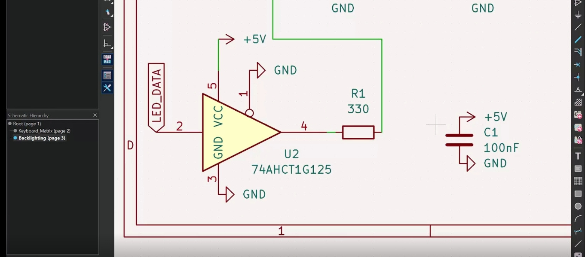
I was pretty sucessful with adding most of the symbols for the chain but was struggling to fit the capacitors to the schematic sheet. To be honest, I was a bit confused at first on how to connect them because I didn't fully understand how it electrically worked. However, after looking at some examplars online, the full image of how the capaciotrs worked finally revealed itself in my mind and I realized I can just connect the capcitors seperately to the 5V and GND on my schematic. However, its getting late so I will contiue tommorow.

[**Laspe Recording**](https://lapse.hackclub.com/timelapse/V8r73G1_ybjy)

**Total time spent: 0.47 hours**

# October 10: Grinding on PCB Work

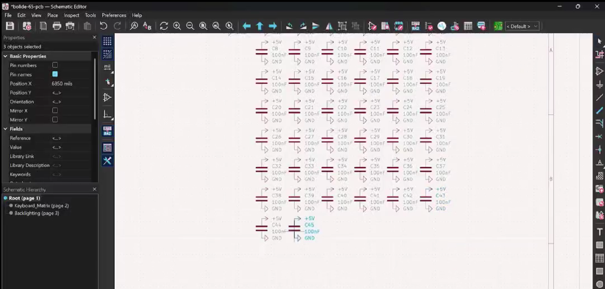
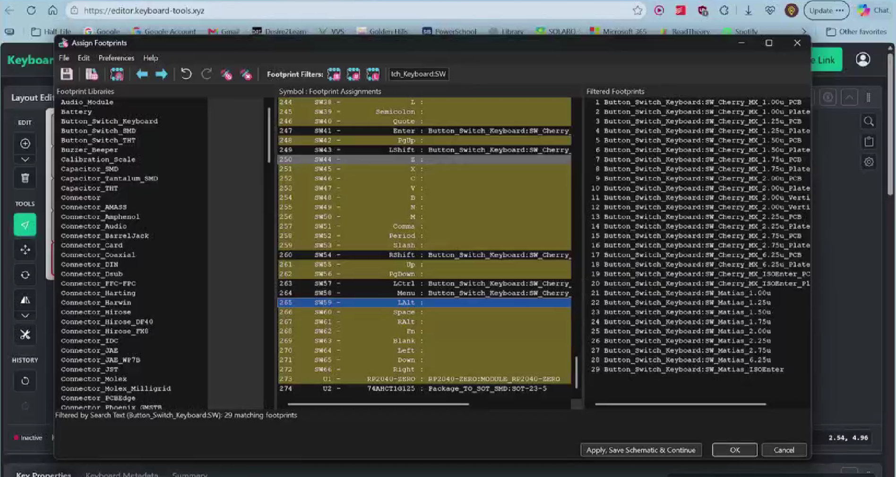

I quickly finished adding those extra LED components to my schematic and then began assigning footprints. One issue I ran into as I was doing this was that I did not use the same 1.00u footprint fro each of my keys. Each key was assigned a footprint accoridng to its size (1.75u, 2.00u, etc). One thing I did not know is that for footprints above 2.00u, the holes for the key stabilizers were included in the footprint, meaning I did not need to include individual MX stabilizers in my design. After debating on if I wanted change my switch footprints, or rather delete my stabilizer footprints and use the combined switch and stabilizer footprint instead, I went with the latter. 

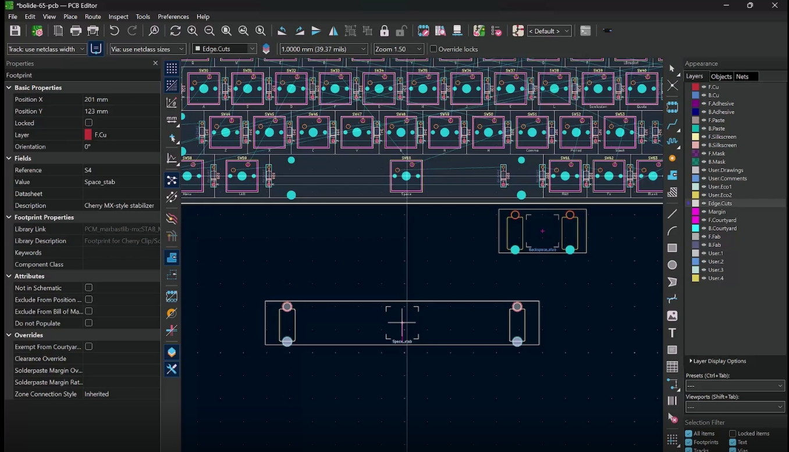

I then spent almost 4 hours placing all my components. Although I was able to slightly speed up my time using KiCad's kbplacer plugin to *only* ensure all my switches were located in the correct place, I still had to do the tedious task of placing all of my diodes and capacitors. I then began routing my PCB, starting with the rows of my matrix as I think they are the least complicated part of the PCB. I shall continue the grind tommorow.

[**Laspe Recording:** Finishing Schematic & Assigning Footprints](https://lapse.hackclub.com/timelapse/EN6MxEgE_b9F)

[**Laspe Recording:** Assigning LED footprints](https://lapse.hackclub.com/timelapse/V5P0em_uG-3q)

[**Laspe Recording:** Starting PCB Layout](https://lapse.hackclub.com/timelapse/ldH9hXX4tdMm)

[**Laspe Recording:** PCB Footprint Placement and Routing**](https://lapse.hackclub.com/timelapse/btrU3aZw4Mqe)

**Total time spent: 5.05 hours**

# October 11: The PCB is DONE!

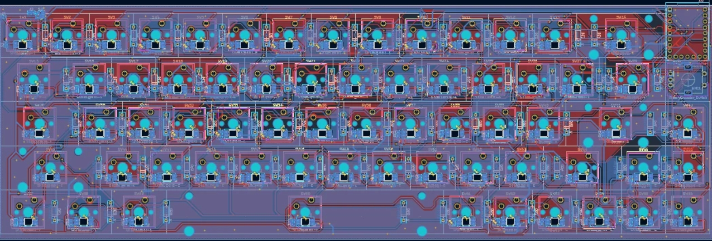

I decided to get up extra early to complete my PCB routing. Something I though would be quick to do quickly turned into a grueling work. I repeatedly had to redo my routing because the layers in which I choose to do my routes contributed to a messier layout. However, I eventually gave up and began using vias galore. (I believe the final design pictured has 459 vias total.😬) One major contribution to my via useage was the fact that when I thought I was done with all my routing, I opened the Design Rules Checker and was shocked to find over 400 errors. Desperate to clear the list, I stopped caring about the aesthetics and just spammed vias until things connected. I think over half my time was spent just fixing the DRC errors. 🫩 

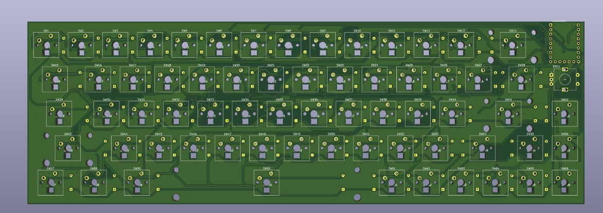
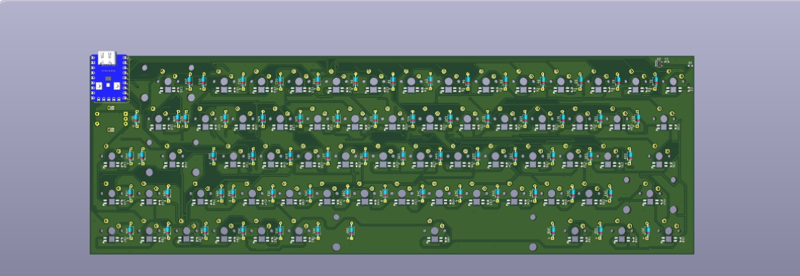

This was definitely due to my inexperience with PCB making in general. For instance, I discovered that I had accidentally placed one section of my LEDs in a way that made tracing it talking only a seconds rather than a couple of minutes, proving I may have made a few inefficient choices during my footprint placement. I also incorrectly assumed that a copper ground pour would automatically link up all my ground components to a ground plane (which heavily contributed to my DRC errors) I hope as I continue to make hardware projects I get more conformable with making efficient routes and better traces.

(I am adding extra time to account for the time I spent updating my BOM as I was making my PCB)

[**Laspe Recording:** Routing](https://lapse.hackclub.com/timelapse/-45GtTBscDO9)

[**Laspe Recording:** It's FINALLY done](https://lapse.hackclub.com/timelapse/HCnOruETElv0)

**Total time spent: 7.59 hours**

# October 17: Polishing PCB

I took a bit of a break as I was quite busy this week. Yesterday, I spent about 30 minutes actually completing my `BOM.csv` with all the components I would need for my PCB assembly. Today, I spent some time polishing my PCB and completing some basic firmware so I can test my PCB once its assembled. 

Regarding my PCB polish, I decided I actually did not like having a bunch of silkscreen warnings and worked on clearing our my DRC report completely. Once I had achieved two green zeros, I added some custom text to the silkscreen to personalize my PCB a bit more.

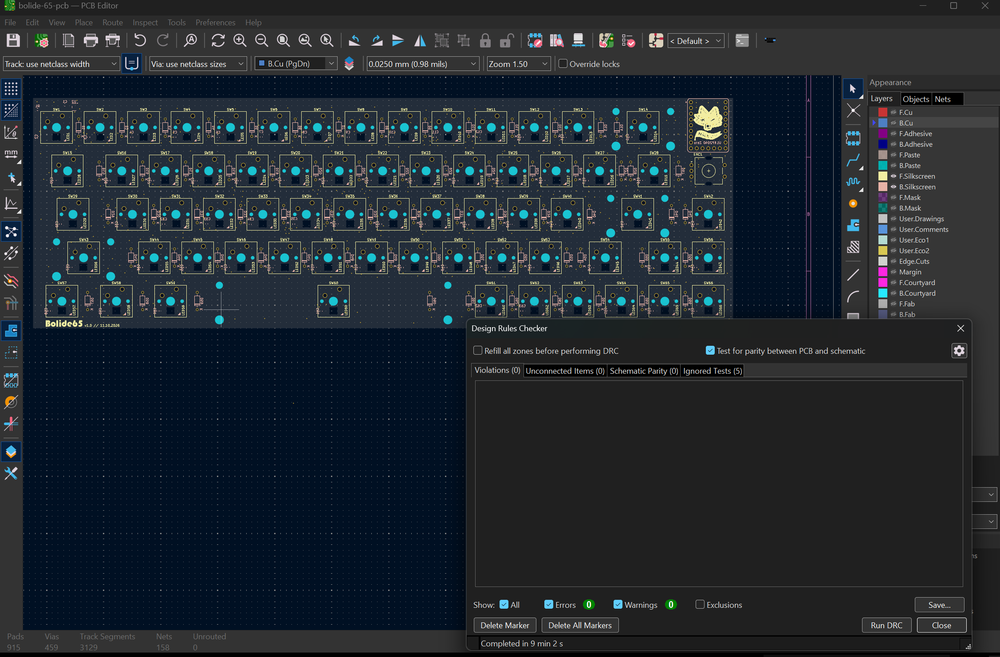

Reagarding my firmware, I used QMK as it is the firmware platfrom I am most familiar with (used it to make my macropad). I also appreciate I don't have to write much code for my keyboard if I use `qmk new-keyboard` in the QMK MSYS as it gives you "template" code that matches standard layouts and common microcontrollers. I only used AI only to adjust the `keyboard.json` matrix positons to accurately mathc my custom layout. Otherwise, I ordered the LED matrix according to the "S" path I arranged them in when making my PCB and gave standard functionality to all my keys. Based on my sister's suggestions, I made it so my rotary controller controls volume and that my custom macro key (on the bottom row) changes the backlighting color. (I'm just writing this here as a future note to self: enabled rotary encoder to controled LED brightness on `fn` mode).

Unfortunately, the time tracked on hackatime was added to the previous firmware work I did for my macropad, so I can;t ink my hackatime to my project. I saw able to get a screenshot of the time I worked specifically for just this keyboard though:

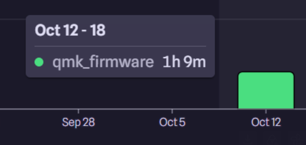

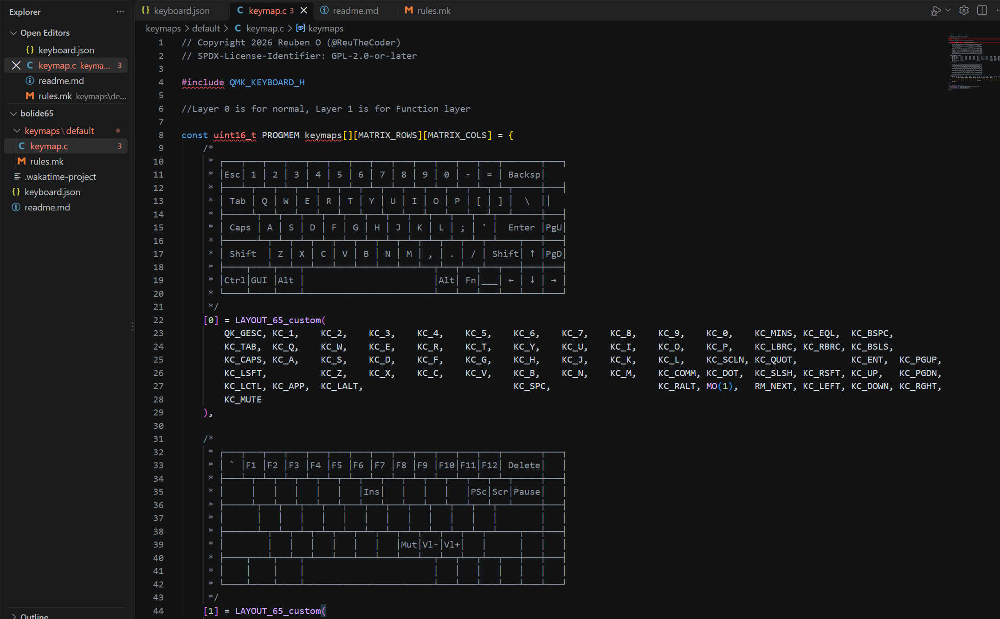

I hope my firmware works right off the bat. I was (eventually) able to compile it with no issues (I had accidently mispelled a line of code, causing the whole `keymap.c` file to not register) so I am hoping for the best. I'm going to start working on the case tommorow.

**Total time spent: 2.65 hours**

# October 18: Starting to use CAD

Before I actually began to CAD, I spent a bit of time adding most of the 3D models for my PCB components so I had an accurate reference to use when making my case design. Thank you to [GrabCAD](https://grabcad.com/library/cherry-mx-stabilizer-mx-1) and the [scottokeebs](https://github.com/joe-scotto/scottokeebs/tree/main/Extras/ScottoKicad/3dmodels) Github for some of the 3D models I needed! I decided to use Onshape for my case design (despite previously using Fusion360 for my macropad) as it is a CAD platform I would like to get comfortable with and I thought it would be slightly less laggy than when using Fusion (something I am not sure is true after using it). Once I actually began my to CAD, I ran into an issue of how to properly align my top plate (which I generated using the [ai03 Plate Generator](https://kbplate.ai03.com/) with my keymap .json I made in the keyboard layout editor) to my PCB. At first I though I could just enter it in a rectangle with my PCB diemensions but that quickly proved to be difficult. I eventually realized it would be easier to do so my editing it in context in an assembly file with my PCB 3D model.

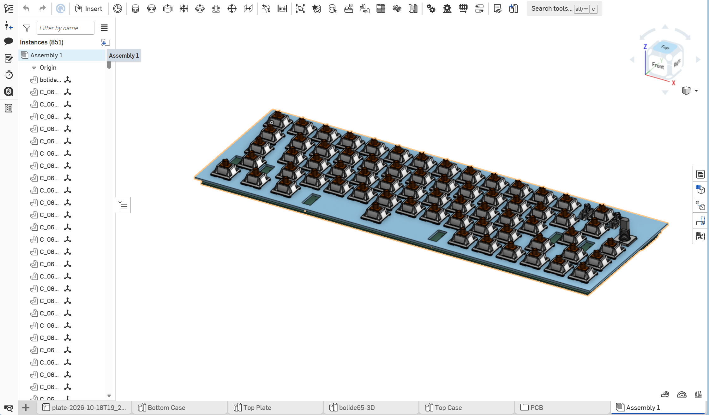

I'm debating whether I shoudl design this for a resin print through JLC PCB or stick with PLA printing (as they appear to be similar prices - depending on the resin I choose). Hopefully I decide by tomorrow.

[**Lapse Recording:** Starting Keyboard Case](https://lapse.hackclub.com/timelapse/YFk4QdU-h-rW)

[**Lapse Recording:** Completing Top Plate](https://lapse.hackclub.com/timelapse/dwQVN7j-ZHKL)

It was at this point where I realised I should switch this project to a different hardware YSWS because I knew I would not be able to complete my Week 2 submission in time. Now that is project is on Hackclub's [Forge YSWS](https://forge.hackclub.com/), I can take my time to create a keyboard I ma pround of and my sister is happy with!

**Total time spent: 2.07 hours**

# October 19: CAD Continues

Did a quick work session today after finishing my homework. I polished up my top plate and got to work on my middle plate. I’m not going for a high profile look (where the bottom of the switches are hidden by the case) because want to highlight the transparent switches I chose for this keyboard. The reason I have a top and middle plate is because the middle plate is meant to be a transparent or translucent decorative piece that shines a beam of light through the case. The top plate hold the PCBs, and the middle plate kind of acts like a support. 

I also decided I will go with resin printing (primarily because I won’t have to slice my keyboard case due to it being too wide and also because it has less noticeable layer lines). The walls are 3mm as I read anything thicker is more probable to cause warping or unnecessary stresses to the keyboard.

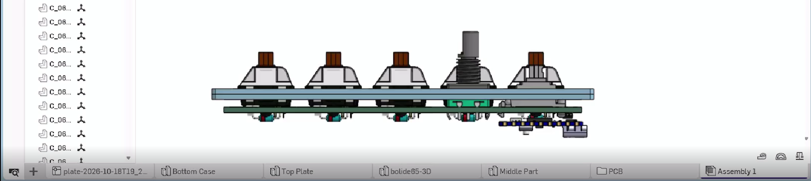

Now that I have the length and width of my keyboard solidified, I can figure out the height of my bottom case. From what I have seen online, a good ergonomic height for keyboards is 18mm. I want my keyboard to have a 5° incline, so I got to do some trig with my keyboard width to figure out how tall the end of my bottom case should be.

[**Laspe Recording**](https://lapse.hackclub.com/timelapse/5f_QfFB462Bp)

**Total time spent: 0.53 hours**

# October 20: The Case is Taking Shape

As I was planning my bottom case dimensions I realized I forgot on critical thing: *SCREWS*! I completely ignored the fact I actually had to design a way to hold the case together. I have a bunch of M3x16mm screws and M3 heatset inserts, so I decided I wanted to use those. You can’t actually use a solder to insert heat set inserts, so it’s recommended that you glue it into a resin print. After a bit of research, I determined will need a 8.5mm cylinder in each corner of my case in order to have enough space to fit my screws (as my walls are too thin and my PCB is in the way) so I spent this CAD session readjusting my top plate and middle case dimensions to accommodate these holes.

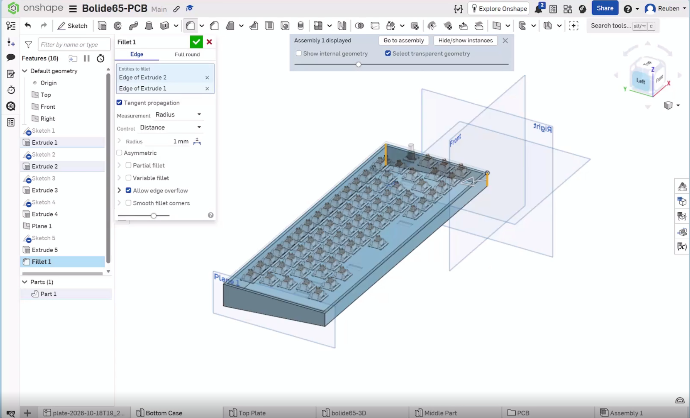

Afterwards I began make the bottom case. Using trigonometry (Height Difference = Case Depth * tan(5°)), I have determined my case has an approximately 4.7° incline. There were so many instances were I was stuck just because I did not know how to use an Onshape feature properly. For instance, when I tried to sketch out the left wall for the bottom case enclosure, the sketch kept being drawn on the right side of the keyboard enclosure. I eventually figured out that I had to add a plane to the left face of my case which I wanted to make the sketch on, but did not realize I had to set the offset to zero. On the bright side, I can definitely see my Onshape knowledge improving.

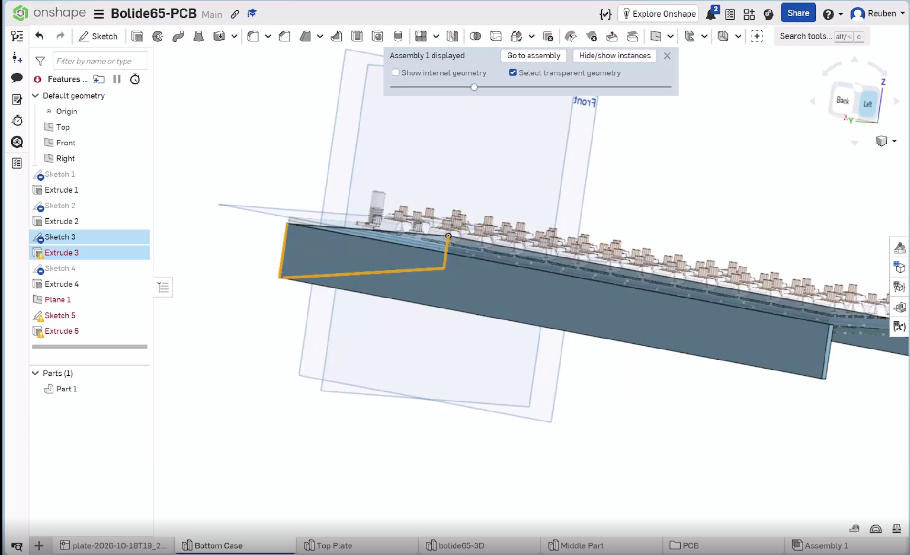

[**Laspe Recording**](https://lapse.hackclub.com/timelapse/fnvAShl7yg8w)

**Total time spent: 2.08 hours**

# October 21: I'm DONE!

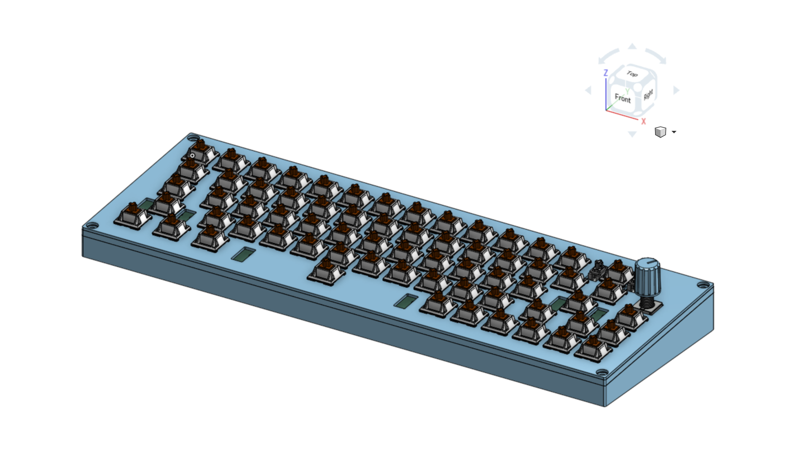

After grinding out my CAD work throughout the day, the CAD is done!

This morning, I had the intention of adding the screw holes to my case, but decided I was not happy with the case proportions. The clear middle plate is meant to be a key feature of my keyboard design, yet I left it as a small sliver of the whole case. I am much more happy with its proportions now. 

Doing that took up my whole morning though, so when I came back home from school I began to work on the screw holes. After taking some time to figure out the exact dimensions I would need to fit my M3x16mm screws, it was a pretty straightforward process. I decided to screw my case from the top. I gave the top plate a hole with a diameter of 6.5mm to accomodate the size of the button head screw I will be using. The middle plate uses a counterbore that transitions the 6.5mm hole into a 3.2mm hole to guide the screw into the right place. The hole bottom case expand back out to 4.7mm so I can glue in my M3x5mmx4mm heatset insert into my PCB enclosure. Afterwards, I did a little polsihing, added the USB cutout and made a custom knob for my rotary encoder. Bonus: I finally remembered the dimensions tool! There were DEFINITELY a few instances before this where I could have really used that. Futher proof this project is jogging my memory of former CAD skills. On the other hand, I was pretty irritated when I realized as I was making a custom rotary encoder knob (the LAST thing I did) that I could just unhide sketches after I make an extrude. I though Onshape just got rid of the sketches from the workspace, so I kept redoing sketches I needed to reuse...when there was no reason to do so.

(I decided I'm going to add 30 minutes to my total time to account for the time I spent researching and going over my measurements and calcuations to ensure everything will fit together correctly during assembly)

However, it's all done now! I am considering pivioting my top plate to be made out of a White FR4 PCB plate, using a DXF generated from my CAD file (because the top plate is a bit too thin to print with cheap resin), but regardless, I can call the keyboard design process done!

[**Laspe Recording**: Morning Session](https://lapse.hackclub.com/timelapse/OzhAD28hx0db)

[**Laspe Recording**: Evening Session](https://lapse.hackclub.com/timelapse/DU_oq926-Xdc)

**Total time spent: 3.53 hours**

# October 22: One Last Thing...

After a little debate in my head I decided I would quickly whip up an alternative top plate design. This one uses the exact same layout as the CAD top plate (I just exported it's `.dxf` into KiCAD), but now instead of being 3D printed, its is made of FR4 (fiberglass). From what I've read online, this alternative top plate may produce a more satisfying sound when the switches are pressed. Also, the white PCB color may match better with the 9600 Resin, compared with the alternative resin i had to choose due to how thin my PCB was. I added it to the PCB folder and excluded it from the BOM as it is completely optional (and more expesnive).

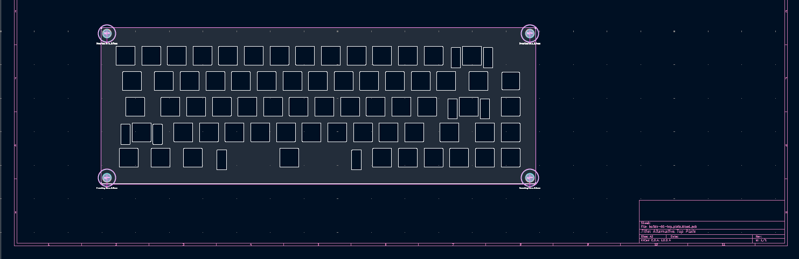

Hopefully the next log will be a build update!

**Total time spent: 0.42 hours**