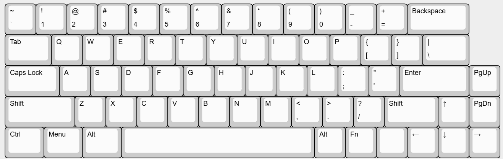
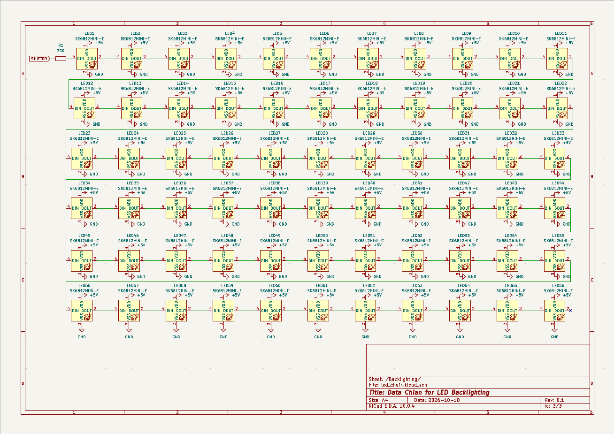
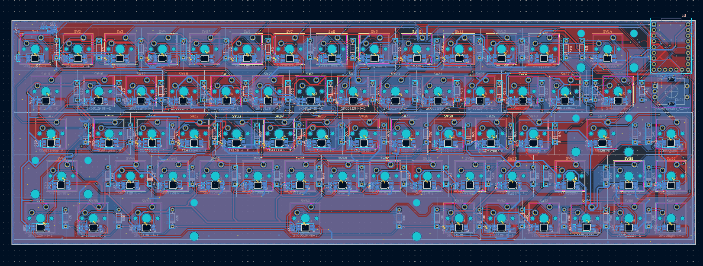

# Bolide65
Bolide65 is a 66 key, 65% keyboard with a rotary encoder and RGB backlighting under each key. It was built as my Week 1 submission for Hack Club's [Half-Life](https://halflife.hackclub.com/projects/cmunbffu2003001lze9z86fa2) program, in which I was challenged to design a PCB in one week.

 

## Features

- 66 Cherry MX-compatible keys in a custom 65% layout
- EC11 rotary encoder (push button enabled)
- RP2040-Zero microcontroller (USB-C) using QMK firmware
- 66 reverse mount SK6812MINI-E RGB LEDs on a single data chain
    - 74AHCT1G125 level shifter on the LED data line (3.3 V to 5 V) 
- 2-layer PCB with GND copper pours on both sides
- 4 PCB mounted stabilizers

## Layout
 

*The keymap layout (`Bolide65_Layout.json`) was made with [Keyboard Layout Editor NG](https://editor.keyboard-tools.xyz/).

A 6.25u screw-in stabilizers is needed for the Backspace key, while 2u screw-in stabilizers are needed for the Enter, Left Shift, and Space keys. Any 65% compatible keycap set will work with this project. The one listed in the BOM was chosen for its see-through effect and low cost. The blank space in the top-right corner of the keymap is on purpose, as it leaves room for the microcontroller and the encoder. The blank keys is meant to be a custom macro.

## PCB

This is the PCB (307x101mm) I made for Bolide65, made in KiCad 10.0. Most of the footprints came from the [Marbastlib](https://github.com/ebastler/marbastlib) library, the microcontroller footprint was sourced from [SnapMagic](https://www.snapeda.com/parts/RP2040-ZERO/Waveshare%20Electronics/view-part/), and anything else came from KiCad's default libraries. I used the kbplacer plugin to correctly arrage the switches according to my keymap. 

The microcontroller, LEDs, diodes, resistors, and capacitors are meant to be soldered to the back of the board, while everything else is soldered tot the front. It is a 2 layer PCB with GND copper pours on both sides, and DRC passes with only silkscreen warnings. (No errors) 

**Schematic:**

The project is split across three sheets: the root sheet (microcontroller, level shifter, LED capacitors, stabilizers), the key matrix, and the LED chain.

**PCB:**

<!-- DO ASAP: add PCB screenshots -->

## Firmware 
The QMK firmware the keyboard microcontroller must be flashed with includes the matrix, encoder, and RGB matrix settings for the RP2040. Some notable firmware features are:
- Each function (F1, F2, etc) does not have its own button. Rather, each function can be accessed through the number row while holding down the `fn` key.
- The spare macro key switches through backlighting animations (normal press goes to next and shift goes back) and pressing it while on the `fn` setting changes the LED color.
- This keyboard uses the Grave Escape, so a plain press acts as the escape key, pressing shift inputs `~` and pressing it while on the `fn` setting inputs the backtick `.

## CAD

The case design will be published later as it was not able to be completed within the 1 week timeframe of this project.

## Bill of Materials [BOM]:
All the components needed for this keyboard:

| Item Name | Qty | Price (USD) | Item link | Notes |
|---|---|---|---|---|
| 330 Ω 0603 resistor [Uni-Royal 0603WAF3300T5E] | 100 | $0.26 | [LCSC](https://www.lcsc.com/product-detail/Chip-Resistor-Surface-Mount_UNI-ROYAL-Uniroyal-Elec-0603WAF3300T5E_C23138.html) | Must purchase 100 in order to source the 1 resistor needed. 0603, SMD |
| 0.1 µF Ceramic Capacitors [Samsung Electro-Mechanics CL10B104KB8NNNC] | 100 | $0.79 | [LCSC](https://www.lcsc.com/product-detail/C1591.html) | Must purchase 100 in order to source the 67 capacitors needed. 0603, SMD |
| 74AHCT1G125 Level Shifter [TI SN74AHCT1G125DBVR] | 5 | $0.50 | [LCSC](https://www.lcsc.com/product-detail/C7484.html) | Must purchase 5 in order to source the 1 level shifter needed. SOT-23-5, use the AHCT version, not AHC |
| Fast Switching Diode [Changzhou Starsea Elec 1N4148] | 100 | $1.34 | [LCSC](https://www.lcsc.com/product-detail/C85057.html) | Must purchase 100 in order to source the 67 diodes needed. Through-hole (DO-35) |
| SK6812 MINI-E Addressable LEDs | 70 | $4.56 | [LCSC](https://www.lcsc.com/product-detail/Light-Emitting-Diodes-LED_OPSCO-Optoelectronics-SK6812MINI-E_C5149201.html) | Must purchase 70 in order to source the 66 LEDs needed. Reverse mount. (Price is higher here than on Half-Life submission because I already own some LEDs) |
| Custom PCB | 1 | $19.00 | [JLCPCB](https://github.com/ReuTheCoder/bolide-65-keeb/blob/main/assets/bolide-pcb_quote.png) | Uses default PCB settings on JLCPCB |
| Womier Pudding Keycaps, Black PBT Shine Through (130 Keycap Set) | 1 | $12.61 | [Amazon](https://www.amazon.ca/Womier-Pudding-Keyboard-Switches-Keyboard-Black/dp/B0D4DN5HK1?source=ps-sl-shoppingads-lpcontext&smid=AZ1RQDED92VC&th=1) | Keycap choice is not mandatory. Can choose other keycap set; see-through recommended. Matching key sizes specified in additional notes |
| PCB Mount Screw In Stabilizers (1x 6.25u, 4x 2u) | 1 | $4.72 | [Amazon](https://www.amazon.ca/Mechanical-Keyboard-Stabilizers-Stabilizer-Backlight/dp/B0GS7HQJP6?source=ps-sl-shoppingads-lpcontext&th=1) | Stabilizer choice is not mandatory. Can choose other screw in stabilizer set. 3x 2u, 1x 6.25u |
| Glorious Fox Linear Mechanical Switches (110 pcs) | 1 | $23.09 | [Amazon](https://www.amazon.ca/Glorious-Linear-Mechanical-Switches-Keyboards/dp/B0D7QW8SQ9?th=1) | Switch choice is not mandatory. Can choose other MX-style switch |
| Waveshare RP2040 Zero | 1 | $4.20 | [RobotShop](https://ca.robotshop.com/products/rp2040-zero-pico-like-mcu-board-based-on-rp2040-mini-version-w-o-header) | Ensure you have pin headers |
| EC11 Rotary Encoder | 1 | $2.22 | [LCSC](https://www.lcsc.com/product-detail/C202365.html) | Excluded from half-life submission as it is already owned. Plus a knob |
| **Total Price (USD):** | | **$73.29** | | |
## Additonal Notes

This was my second ever PCB project and I am quite satisfied with what I could get done in a week! Below is an explanation of some technical choices I made for my PCB schematics:
- No hotswap; this keyboard is meant to have all its components hand soldered to it. It's cheaper, and I wanted to get more soldering experience.
- The encoder's push button is wired throough the matrix (9 columns by 8 rows) so it can be used when pushed (function not decided yet) while its rotation pins go straight to the microcontroller GPIO.
- To protect my LEDs and ensure stable signal transmission, its data chain passes through the level shifter (U2) and a 330 Ω series resistor (R1) before LED1, and every LED has its own 0.1 µF decoupling capacitor (C2-C67), with C1 for the shifter. I did not add a bulk capacitor, so brightness should be capped in firmware to stay within USB power limits.

**Keycap Sizes**
| Key | Size |
|---|---|
| Backspace | 2u |
| Tab, Backslash | 1.5u |
| Caps Lock, Right Shift | 1.75u |
| Enter, Left Shift | 2.25u |
| Ctrl, Menu, Left Alt | 1.25u |
| Space | 6.25u |
| All remaining keys | 1u |

Many thanks to the creators of Marbastlib and kbplacer for making my life easier. Also, I would like to say thank you so much to the organizers of [Forge](https://forge.hackclub.com/) and those at the [HackClub](https://hackclub.com/) hq for this wonderful hardware exploration opportunity!

