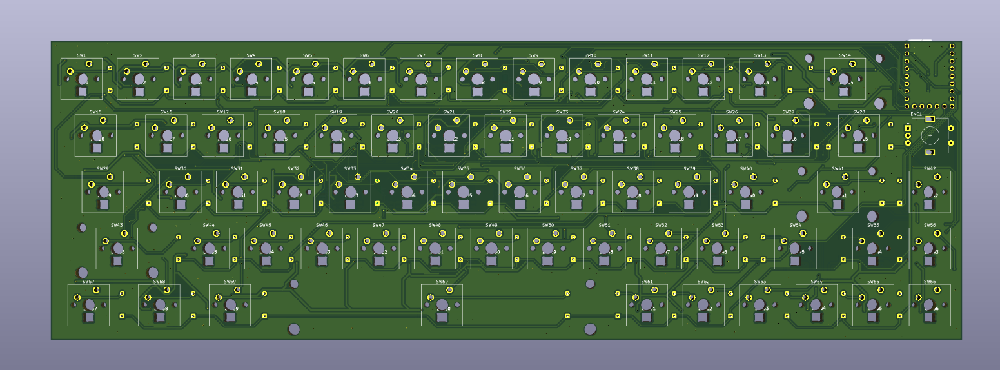
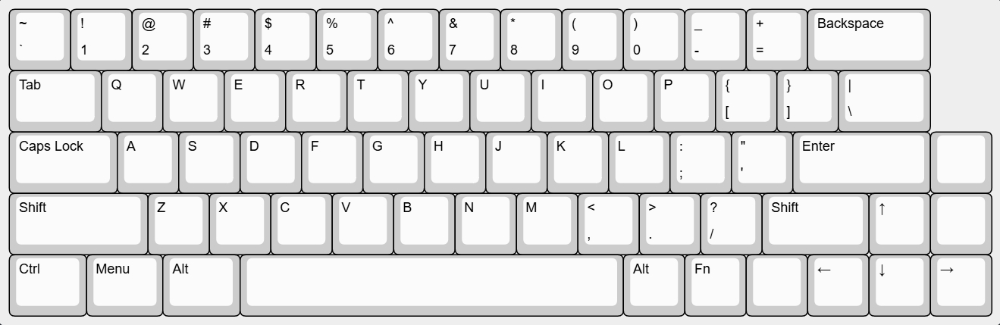
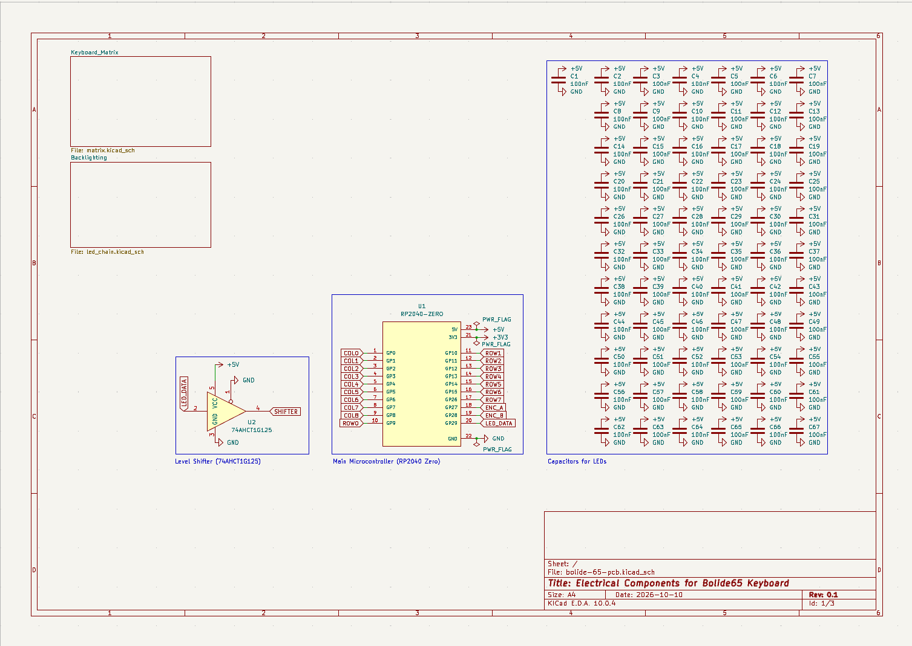
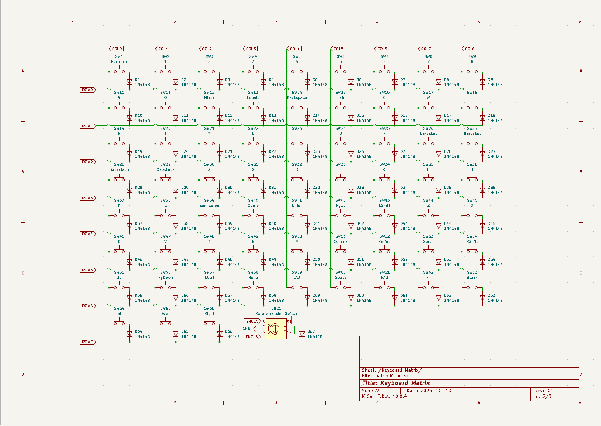

# Bolide65
Bolide65 is a 66 key, 65% keyboard with a rotary encoder and RGB backlighting under each key. It was built as my Week 1 submission for Hack Club's [Half-Life](https://halflife.hackclub.com/projects/cmunbffu2003001lze9z86fa2) program, in which I was challenged to design a PCB in one week.

 

## Features

- 66 Cherry MX-compatible keys in a custom 65% layout (including PgUp, PgDn, and one spare key)
- EC11 rotary encoder (push button enabled)
- RP2040-Zero microcontroller (USB-C) using QMK firmware
- 66 reverse mount SK6812MINI-E RGB LEDs on a single data chain
    - 74AHCT1G125 level shifter on the LED data line (3.3 V to 5 V) 
- 2-layer PCB with GND copper pours on both sides
- 4 PCB mounted stabilizers

## Layout
 

*The keymap layout (`Bolide65_Layout.json`) was made with [Keyboard Layout Editor NG](https://editor.keyboard-tools.xyz/).

A 6.25u screw-in stabilizers is needed for the Backspace key, while 2u screw-in stabilizers are needed for the Enter, Left Shift, and Space keys. Any 65% compatible keycap set will work with this project. The one listed in the BOM was chosen for its see-through effect and low cost.

## PCB

This is the PCB I made for Bolide65, made in KiCad 10.0. Most of the footprints came from the [Marbastlib](https://github.com/ebastler/marbastlib) library, the microcontroller footprint was sourced from [SnapMagic](https://www.snapeda.com/parts/RP2040-ZERO/Waveshare%20Electronics/view-part/), and anything else came from KiCad's default libraries. I used the kbplacer plugin to correctly arrage the switches according to my keymap. 

The microcontroller, LEDs, diodes, resistors, and capacitors are meant to be soldered to the back of the board, while everything else is soldered tot the front. It is a 2 layer PCB with GND copper pours on both sides, and DRC passes with only silkscreen warnings. (No errors) <!-- Later: board dimensions and thickness -->

**Schematic:**

The project is split across three sheets: the root sheet (microcontroller, level shifter, LED capacitors, stabilizers), the key matrix, and the LED chain.

<!-- DO ASAP: add schematic screenshots -->

**PCB:**

<!-- DO ASAP: add PCB screenshots -->

## Firmware & CAD

QMK firmware for this board and the case design will be published later as they were not able to be completed within the 1 week timeframe of this project.

<!-- DO ASAP: configure in QMK with the matrix, encoder, and RGB matrix settings for the RP2040. -->

## Bill of Materials [BOM]:
All the components needed for this keyboard:
- 66x MX-style switches 
- 66x keycaps (matching key sizes specifed in additonal notes)
- 4x stabilizers (3x 2u, 1x 6.25u) 
- 67x through-hole 1N4148 diodes (DO-35)
- 66x SK6812 MINI-E LEDs (reverse mount)
- 67x 0.1 µF X7R 0603 capacitors (smd)
- 1x 330 Ω 0603 resistor (smd)
- 1x 74AHCT1G125 level shifter (SOT-23-5, use the AHCT version, not AHC)
- 1x Waveshare RP2040-Zero
- 1x EC11 rotary encoder with push switch, plus a knob

## Additonal Notes

This was my second ever PCB project and I am quite satisfied with what I could get done in a week! Below is an explanation of some technical choices I made for my PCB schematics:
- The blank space in the top-right corner of the keymap is on purpose, as it leaves room for the microcontroller and the encoder.
- No hotswap; this keyboard is meant to have all its components hand soldered to it. It's cheaper, and I wanted to get more soldering experience.
- The encoder's push button is wired throough the matrix (9 columns by 8 rows) so it can be used when pushed (function not decided yet) while its rotation pins go straight to the microcontroller GPIO.
- To protect my LEDs and ensure stable signal transmission, its data chain passes through the level shifter (U2) and a 330 Ω series resistor (R1) before LED1, and every LED has its own 0.1 µF decoupling capacitor (C2-C67), with C1 for the shifter. I did not add a bulk capacitor, so brightness should be capped in firmware to stay within USB power limits.

**Keycap Sizes**
| Key | Size |
|---|---|
| Backspace | 2u |
| Tab, Backslash | 1.5u |
| Caps Lock, Right Shift | 1.75u |
| Enter, Left Shift | 2.25u |
| Ctrl, Menu, Left Alt | 1.25u |
| Space | 6.25u |
| All remaining keys | 1u |

Many thanks to the creators of Marbastlib and kbplacer for making my life easier. Also, I would like to say thank you so much to the organizers of [Half-Life](https://halflife.hackclub.com/) and those at the [HackClub](https://hackclub.com/) hq for this wonderful hardware exploration opportunity!

